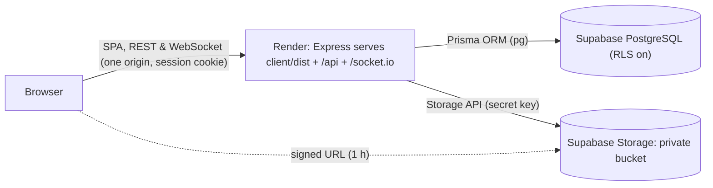

<div align="center">
      
    <br/>
    <br/> 
    
</div>

# Web Chat Real-Time (GDG-HUST Realtime Chat)

> A production-grade, feature-rich real-time web chat platform crafted for **Google Developer Groups on Campus • Hanoi University of Science and Technology (GDG-HUST)**, supporting 1-1 direct messaging and multi-user room chats, built with a full-stack TypeScript Monorepo architecture.

[]()
[](https://www.typescriptlang.org/)
[](https://nodejs.org/)
[](https://react.dev/)
[](https://socket.io/)
[](LICENSE)

---

## Key Features

The system is engineered across three progressive technical tiers, enhanced with the **GDG-HUST / Google Chat Design System**:

### Level 1: Core Prerequisites
* **Real-time Two-Way Communication**: Stable WebSocket / Socket.io bidirectional connection with automatic background room subscriptions.
* **Persistent Message History**: Reliable PostgreSQL database storage with versioned **Prisma Migrate** migrations (the test suites run on an in-memory **PGlite** instance) and historical message retrieval upon reopening chat sessions.
* **Session Cookie Authentication**: Server-side Sessions carried in an `HttpOnly; Secure; SameSite=Strict` cookie for both HTTP REST APIs and Socket Handshake ([ADR 0010](docs/adr/0010-single-host-render-with-session-cookie.md)), revocable with **Sign out** and **Sign out of all devices**, paired with a **Zero-Shift Auth UI**.

### Level 2: Standard Enhancements
* **Room Chats**: Multi-user group chat spaces with role-based administration (`OWNER`, `ADMIN`, `MEMBER`).
* **Real-time Presence**: Live `Online` / `Offline` / `Last seen` statuses equipped with a 5-second anti-flicker grace period buffer.
* **Typing Indicators**: Live real-time debounced typing notifications for both 1-1 and group rooms.
* **Rich Media Integration**: Built-in Emoji picker popover and GIF search modal via Giphy API (with curated fallback GIFs).

### Level 3: Advanced Capabilities & Responsive UX
* **Private File Attachments & Previews**: Upload images (with thumbnail previews & full-screen **Image Lightbox**) and documents (with in-app **Document Preview Modal**) up to 10MB. Files are type-checked by content, stripped of EXIF metadata, stored in a private Supabase bucket and shown through short-lived signed URLs ([ADR 0009](docs/adr/0009-private-attachments-via-records-and-signed-urls.md)).
* **Dual-Layer Sync Strategy**: Automatic network recovery and missed message synchronization (Socket.io Connection State Recovery `< 2 min` + REST Catch-up Sync `> 2 min`).
* **Delivery Tracking, Read Receipts & Unread Counters**: Real-time delivery state transitions (`SENT` $\rightarrow$ `DELIVERED` $\rightarrow$ `READ` with a moving `Seen [Mini-Avatar]` watermark) and live unread badges (`unreadCount`).
* **Cursor-based Pagination**: Infinite scroll message history loading (`limit=50`, `before=<id>`, `after=<id>`) for smooth scroll performance.
* **Browser Push Notifications**: HTML5 Web Notifications accompanied by an audio chime when the app runs in the background.
* **Adaptive Multi-Device Layout**:
  * **Mobile (`< 768px`)**: Master-Detail navigation with `100dvh` dynamic viewport height and a dedicated mobile back button without unmounting real-time socket state.
  * **Desktop (`>= 768px`)**: Dual-Pane layout featuring a fixed `352px` (`md:w-88`) sidebar and a **Persistent Detail View** when switching between Direct Chats and Rooms tabs.

---

## Tech Stack & Architecture

- **Monorepo Manager**: NPM Workspaces (`shared`, `server`, `client`)
- **Backend**: Node.js, Express, Socket.io, TypeScript
- **Frontend**: React 18, Vite, Tailwind CSS, Lucide Icons, TypeScript
- **Database & ORM**: PostgreSQL (Supabase) + Prisma v7 Migrate & Driver Adapters (`@prisma/adapter-pg`, in-memory `@electric-sql/pglite` for tests)
- **Storage**: Storage Adapter Pattern: Supabase Storage (private bucket, signed URLs) in production, local disk in development, in-memory in tests
- **Security**: Server-side Sessions in a `__Host-session` cookie, `helmet` (CSP, HSTS...), `zod` schemas shared by client and server, `express-rate-limit`, structured `pino` logs
- **Testing**: Vitest + Supertest (Backend) & Vitest + React Testing Library + JSDOM (Frontend)

Production is a **single host** on Render ([ADR 0010](docs/adr/0010-single-host-render-with-session-cookie.md)): one Express process serves the built SPA, the REST API and Socket.IO from the same origin, so there is no CORS.



---

## Project Structure

```text
webchat-realtime/
├── package.json                 # Monorepo root configuration & scripts
├── tsconfig.base.json           # Shared TypeScript base config
├── render.yaml                  # Render blueprint (single host, no secret values)
├── SECURITY.md                  # Security policy: scope, private reporting, accepted risks
├── GLOSSARY.md                  # Domain terminology & GDG-HUST design vocabulary
├── .githooks/pre-commit         # gitleaks secret scanning hook
├── image_gdg/                   # GDG-HUST brand assets (banner & logo)
├── docs/                        # ADRs (0001 - 0010), System Architecture, migrations, incident runbook
├── shared/                      # Shared Contracts package (@webchat/shared)
│   └── src/
│       ├── dtos.ts              # Data Transfer Objects & normalizeDirectChatPair
│       ├── enums.ts             # RoomRole, MessageType, MessageStatus
│       ├── errors.ts            # ERROR_CODES shared by REST errors and socket acks
│       ├── validation.ts        # zod schemas shared by client and server
│       └── events.ts            # SOCKET_EVENTS constants & typed payloads
├── server/                      # Backend API & WebSocket Server (@webchat/server)
│   ├── prisma/
│   │   ├── schema.prisma        # Prisma database schema definition
│   │   ├── migrations/          # Versioned Prisma Migrate migrations (0_baseline, RLS, ...)
│   │   └── schema.sql           # GENERATED DDL for PGlite in tests (npm run db:schema-sql)
│   ├── src/                     # Config, server factory, controllers, routes, socket handlers, storage adapters
│   │   ├── cli/                 # Operator commands: data upgrade, Session revocation
│   │   └── upgrade/             # Data upgrade steps
│   └── tests/                   # Backend integration & boundary test suites
└── client/                      # Frontend React SPA (@webchat/client)
    └── src/
        ├── components/          # Auth, Chat, Common, Dashboard, Media & Room UI
        ├── context/             # AuthContext & SocketContext
        ├── hooks/               # Custom hooks (messages, presence, typing, rooms)
        ├── utils/               # API client, safe URL helper, deterministic 4-color avatar, notifications
        ├── test/                # JSDOM test environment setup & fixtures
        └── *.test.tsx           # Client UI & behavior test suites
```

---

## Getting Started & Installation

### Prerequisites
- **Node.js** 20.19 or newer (required by Prisma 7; developed on Node 24) and **npm** 10+
- **PostgreSQL** 15+: a local Postgres, a Docker container, or a free Supabase project. The server always needs a real database; only the test suites use in-memory PGlite.

### 1. Clone the Repository
```bash
git clone https://github.com/duyna1902-source/webchat-realtime.git
cd webchat-realtime
```

### 2. Install Dependencies
Install all workspaces dependencies from the root directory (this also runs `prisma generate`):
```bash
npm install
```

### 3. Environment Configuration
Copy `server/.env.example` to **`server/.env`** and fill it in. The server, the operator commands and Prisma all load `.env` from the `server/` directory (the root `.env.example` is the same file, kept for discoverability). `server/src/config.ts` is the only code that reads these variables. It refuses to start and lists **every** invalid variable, and it never falls back to a default secret.

| Variable | Required | Meaning |
|---|---|---|
| `DATABASE_URL` | Always | Postgres connection string. With Supabase, use the direct or session-mode connection, **not** the transaction pooler on port `6543` (Prisma Migrate fails through it). `memory:` (PGlite) is accepted only under `NODE_ENV=test`. |
| `APP_ORIGIN` | Always | The origin the browser sees, without a path: `http://localhost:5173` in development, `https://webchat-realtime.onrender.com` in production. Every write request and Socket.IO handshake must come from it (CSRF and Cross-Site WebSocket Hijacking protection). |
| `NODE_ENV` | No (default `development`) | `development`, `test` or `production`. |
| `PORT` | No (default `4000`) | Port the server listens on (Render uses `10000`). |
| `STORAGE_PROVIDER` | Must be `supabase` in production | `local` (files in `server/uploads/`, development only) or `supabase`. |
| `SUPABASE_URL` | With `supabase` storage | `https://<project-ref>.supabase.co`. Its origin is also added to the CSP. |
| `SUPABASE_SECRET_KEY` | With `supabase` storage | A Supabase **secret key** (`sb_secret_...`). Never the legacy `anon` or `service_role` keys. |
| `SUPABASE_STORAGE_BUCKET` | With `supabase` storage | The private Attachment bucket, `attachments`. |
| `LOG_LEVEL` | No (default `info`) | `fatal`, `error`, `warn`, `info`, `debug`, `trace` or `silent`. |
| `GIPHY_API_KEY` | No | GIF search; without it the app uses built-in curated GIFs. |

In production the server also refuses to start without the built client (`client/dist/index.html`). `JWT_SECRET`, `SUPABASE_ANON_KEY`, `SUPABASE_SERVICE_ROLE_KEY`, `PUBLIC_URL`, the Cloudinary variables and `VITE_API_URL`/`VITE_SOCKET_URL` no longer exist: delete them wherever they are still set.

### 4. Database Migrations
The schema is managed with versioned Prisma Migrate migrations in `server/prisma/migrations/` (`db push` is no longer used). Apply them to your database:
```bash
npm run db:deploy --workspace=server
```
The migration workflow ([`docs/database-migrations.md`](docs/database-migrations.md) has the details):
1. **Baseline**: `0_baseline` is the schema production had when it was created with `db push`. An existing database created that way is marked as already having it, once: `npx prisma migrate resolve --applied 0_baseline` (run from `server/`). A fresh database needs nothing special.
2. **`migrate deploy`**: applies every pending migration. On Render it runs automatically in the start command, before the server starts.
3. **Data upgrade command**: normalizes existing data to the new rules (usernames, emails, room names, legacy Attachments) and deletes unreferenced bucket objects. Back up with `pg_dump` first, then run it with `--dry-run` and read the report before applying:
   ```bash
   npm run db:upgrade-data --workspace=server -- --dry-run
   npm run db:upgrade-data --workspace=server
   ```

Schema changes follow **expand → data upgrade → contract**. Every new table must enable Row Level Security; the test suite fails otherwise.

### 5. Run in Development Mode
Start both the backend server and frontend client concurrently:
```bash
npm run dev
```
Open **`http://localhost:5173`**. The Vite dev server proxies `/api`, `/socket.io` and `/uploads` to the backend on `http://localhost:4000`, so development is same-origin, with the same session cookie and `Origin` checks as production. Do not open the app on port 4000 directly: requests from there do not match `APP_ORIGIN`.

---

## Running Tests

Run the entire test suite (backend integration suites, then frontend UI suites):
```bash
npm test
```

Or run backend and frontend test suites individually:
```bash
# Backend integration & socket tests (runs on in-memory PGlite)
npm run test:server

# Frontend React UI & responsive behavior tests
npm run test:client
```

---

## Secret scanning

This repository is public, so secrets must never be committed. Real values live only in your gitignored `.env` and in the Render dashboard; `render.yaml` declares every secret with `sync: false` and holds no values.

A [gitleaks](https://github.com/gitleaks/gitleaks) pre-commit hook in `.githooks/pre-commit` blocks a commit whose staged changes contain a secret. Set it up once per clone:

1. Install gitleaks 8.19 or newer so it is on your `PATH`:
   - Windows: `winget install --id Gitleaks.Gitleaks` (or `scoop install gitleaks`)
   - macOS: `brew install gitleaks`
   - Linux: download a release binary from <https://github.com/gitleaks/gitleaks/releases>
2. Point git at the repository's hooks directory (this only changes this clone's `.git/config`):
   ```bash
   git config core.hooksPath .githooks
   ```

The hook refuses to commit if gitleaks is missing. To scan the whole working tree or the git history by hand:
```bash
gitleaks dir . --redact   # current files
gitleaks git . --redact   # every commit
```

Rules come from `.gitleaks.toml` (the gitleaks defaults plus an allowlist for fake test fixtures in `server/tests/`). Findings that already exist in git history are recorded in `.gitleaksignore`; history is not rewritten, and those keys are treated as compromised and rotated. If gitleaks flags a real secret, do not add it to `.gitleaksignore`: remove it from the change and rotate it.

---

## Deployment: Single Host on Render

Production runs as **one Render web service** ([ADR 0010](docs/adr/0010-single-host-render-with-session-cookie.md)) at `https://webchat-realtime.onrender.com`. The Express server serves the built SPA, the REST API and Socket.IO from that one origin. There is no Vercel deployment and no CORS. The database and the private Attachment bucket live in Supabase.

`render.yaml` is the blueprint:
- **Build**: `npm install --include=dev && npm run build` (shared → server → client).
- **Start**: `npm run db:deploy --workspace=server && npm run start --workspace=server`. Pending migrations are applied before the server starts; if one fails, the server does not start.
- **Health check**: `/health` (liveness). `/health/ready` also checks the database and answers `503` when it is unreachable.
- **Environment**: `NODE_ENV=production`, `PORT=10000`, `APP_ORIGIN`, `STORAGE_PROVIDER=supabase` and `SUPABASE_STORAGE_BUCKET=attachments` are plain values. The secrets `DATABASE_URL`, `SUPABASE_URL`, `SUPABASE_SECRET_KEY` and `GIPHY_API_KEY` are `sync: false`: the file holds no values.

To deploy:
1. Create the service from the blueprint (Render dashboard → **New** → **Blueprint**), or use the existing `webchat-realtime` service. Render asks for `sync: false` values **only when a blueprint is first created**. On an existing service, set or change them by hand under **Environment**, and delete variables that no longer exist (`JWT_SECRET`, `SUPABASE_ANON_KEY`, `SUPABASE_SERVICE_ROLE_KEY`).
2. For a database first created with `db push`, mark the baseline as applied once, before the first deploy that runs `migrate deploy` (see [`docs/database-migrations.md`](docs/database-migrations.md#production-one-time-baseline-ticket-21-done-by-a-human)).
3. Push to `main`. Render builds, runs the migrations and starts the server.
4. Check that `https://webchat-realtime.onrender.com/health/ready` answers `200`, and that after signing in DevTools shows no CSP errors and a `__Host-session` cookie with `HttpOnly`, `Secure` and `SameSite=Strict`.

Free-tier caveats: Render sleeps the instance after 15 minutes without traffic (the first visit then takes 30–50 seconds), and Supabase pauses a free project after about a week without activity. Both are covered in the [incident runbook](docs/incident-runbook.md).

---

## REST API Overview

All endpoints are same-origin under `/api`. Authentication is the `__Host-session` cookie set by register and login; there is no `Authorization` header and no `token` in any response. Every `POST`, `PATCH`, `PUT` and `DELETE` must carry an `Origin` header equal to `APP_ORIGIN` (or `Sec-Fetch-Site: same-origin`), otherwise it gets `403`. Errors have the shape `{ message, code, requestId }`; validation errors add `fields`, and rate-limit errors (`429`, with a `Retry-After` header) add `retryAfterMs`.

| Endpoint | Notes |
|---|---|
| `POST /api/auth/register` | `201 { user }` and sets the session cookie. `user` is the caller's own profile (`SelfUserDto`, with email). |
| `POST /api/auth/login` | Body `{ emailOrUsername, password }`. `200 { user }` and sets the cookie; wrong credentials are always `401` with the same message. |
| `GET /api/auth/me` | `200 { user }` or `401`. |
| `POST /api/auth/logout` | `204`: ends the current Session and clears the cookie. |
| `POST /api/auth/logout-all` | `204`: ends every Session of the user, on every device. |
| `GET /api/users?q=<text>` | User search. `q` is required (1–32 characters after trimming, otherwise `400`), matches usernames only, case-insensitively, and returns at most 20 users as `PublicUserDto` (`{ id, username, isOnline, lastSeenAt }`, no email). The old `?search=` parameter and the full user list are gone. |
| `GET/POST /api/direct-chats`, `GET /api/direct-chats/:id/messages` | Direct Chats and their messages (cursor pagination with `before`/`after`). |
| `/api/rooms/...` | Rooms, Room Members, roles and messages. |
| `POST /api/upload` | Multipart upload (10MB). `201 { attachment }`; disallowed file types get `415`. Send the message with its `attachmentId` over the socket. |
| `GET /api/attachments/:id/url` | Fresh signed URL `{ url, expiresAt }` for a Direct Chat Participant or current Room Member, otherwise `404`. |
| `GET /api/gifs/search`, `GET /api/gifs/trending` | Giphy proxy. |

Other users appear everywhere (member lists, Direct Chat partners, message senders) as `PublicUserDto`; only `/api/auth/*` returns an email.

---

## Security

- Report vulnerabilities privately as described in [`SECURITY.md`](SECURITY.md), which also lists the accepted risks.
- Operators: the [incident runbook](docs/incident-runbook.md) covers the security log events, key rotation, Session revocation (`npm run sessions:revoke --workspace=server -- --user <username|id>` or `-- --all`), impact assessment and user notification.

---

## Documentation

For deep technical dives into our design patterns, data models, domain glossary, and architectural decision records (ADRs `0001`–`0010`), please check out:
- [System Architecture Documentation](docs/adr/SYSTEM_ARCHITECTURE.md)
- [Database migrations](docs/database-migrations.md)
- [Incident runbook](docs/incident-runbook.md)
- [Security policy](SECURITY.md)
- [Domain Glossary (GDG-HUST)](GLOSSARY.md)

---

## License

Distributed under the [MIT License](LICENSE).
