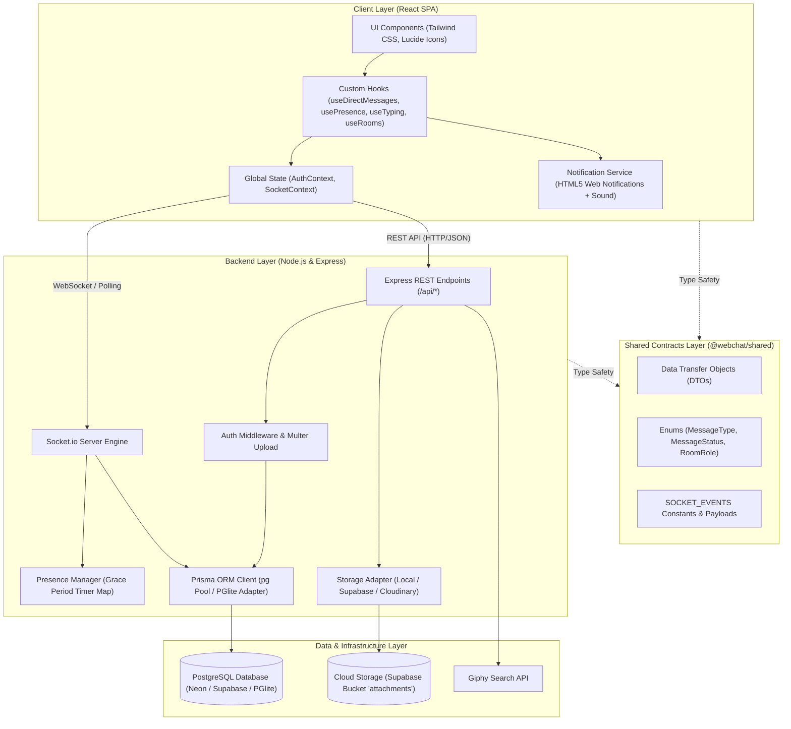
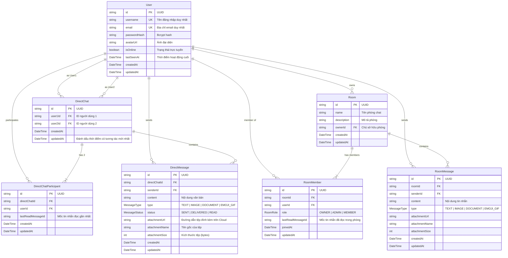
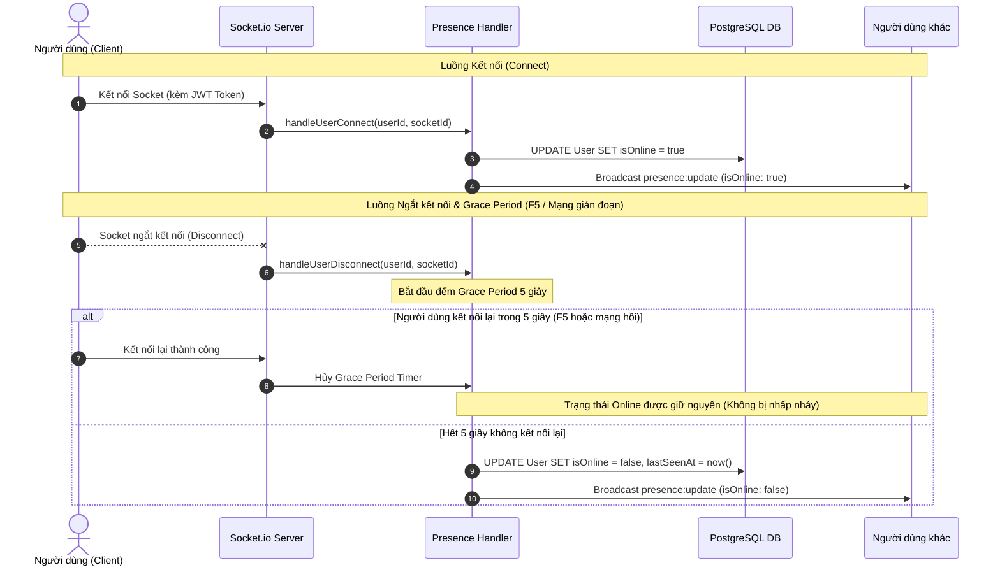
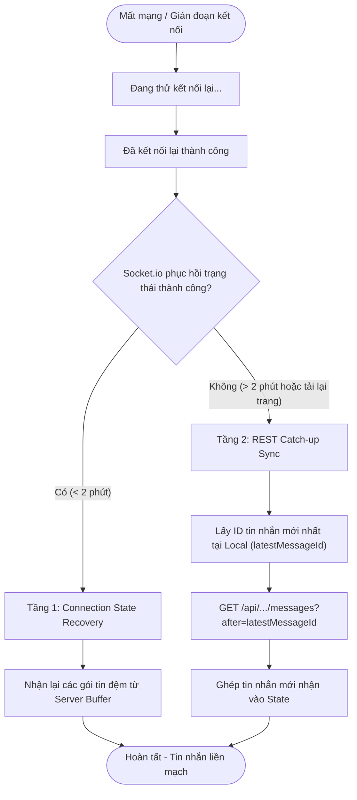
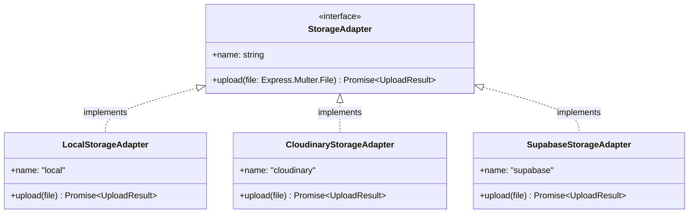
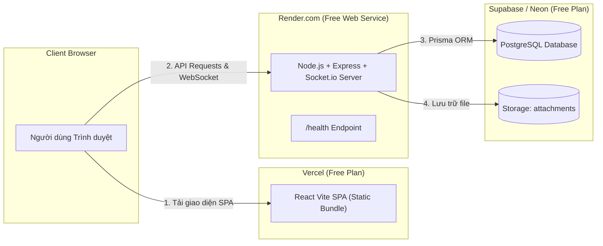

# TÀI LIỆU THIẾT KẾ KIẾN TRÚC HỆ THỐNG
# DỰ ÁN: WEB CHAT REAL-TIME

> **Phiên bản**: 1.1.0  
> **Ngày lập**: 19/10/2026  
> **Trạng thái**: Hoàn thiện & Đã nghiệm thu  
> **Mục đích**: Tài liệu tổng hợp toàn diện kiến trúc kỹ thuật, mô hình dữ liệu, giao thức thời gian thực, thiết kế giao diện đa thiết bị và chiến lược hạ tầng của dự án Web Chat Real-Time (GDG-HUST Realtime Chat).

---

## MỤC LỤC
1. [Tổng quan Dự án & Yêu cầu Nghiệp vụ](#1-tổng-quan-dự-án--yêu-cầu-nghiệp-vụ)
2. [Nguyên tắc Thiết kế & Kiến trúc Tổng thể](#2-nguyên-tắc-thiết-kế--kiến-trúc-tổng-thể)
3. [Cấu trúc Monorepo & Hợp đồng Dữ liệu](#3-cấu-trúc-monorepo--hợp-đồng-dữ-liệu)
4. [Mô hình Dữ liệu & Thiết kế Cơ sở Dữ liệu (Database Design)](#4-mô-hình-dữ-liệu--thiết-kế-cơ-sở-dữ-liệu-database-design)
5. [Kiến trúc Giao thức Thời gian thực (Real-time Socket.io Protocol)](#5-kiến-trúc-giao-thức-thời-gian-thực-real-time-socketio-protocol)
6. [Chiến lược Chống Gián đoạn & Đồng bộ Dữ liệu 2 Lớp (Dual-Layer Sync)](#6-chiến-lược-chống-gián-đoạn--đồng-bộ-dữ-liệu-2-lớp-dual-layer-sync)
7. [Kiến trúc Lưu trữ Tệp & Đa phương tiện (Attachment & Media Strategy)](#7-kiến-trúc-lưu-trữ-tệp--đa-phương-tiện-attachment--media-strategy)
8. [Kiến trúc Phía Client (Frontend SPA Architecture)](#8-kiến-trúc-phía-client-frontend-spa-architecture)
9. [Chiến lược Triển khai Hạ tầng Free-Tier & DevOps](#9-chiến-lược-triển-khai-hạ-tầng-free-tier--devops)
10. [Kiến trúc Kiểm thử & Đảm bảo Chất lượng (Testing & QA)](#10-kiến-trúc-kiểm-thử--đảm-bảo-chất-lượng-testing--qa)

---

## 1. TỔNG QUAN DỰ ÁN & YÊU CẦU NGHIỆP VỤ

### 1.1. Mục tiêu
Xây dựng và vận hành một nền tảng web nhắn tin hai chiều thời gian thực (**GDG-HUST Realtime Chat**) dành cho cộng đồng sinh viên công nghệ Google Developer Groups on Campus • Hanoi University of Science and Technology, cho phép người dùng giao tiếp trực tiếp (1-1) và theo nhóm (Room Chat), hoạt động ổn định trên cả máy tính và điện thoại di động với chi phí hạ tầng **0 đồng (Free-Tier)**.

### 1.2. Ba Cấp độ Yêu cầu Kỹ thuật
Hệ thống được thiết kế và đáp ứng trọn vẹn 3 cấp độ:
- **Cấp độ 1 (Điều kiện tiên quyết)**:
  - Kết nối Real-time hai chiều ổn định qua WebSocket / Socket.io.
  - Lưu trữ lịch sử tin nhắn bền vững trong Database, truy xuất tin nhắn cũ khi mở lại chat.
  - Xác thực người dùng bằng JSON Web Token (JWT) cho cả HTTP REST API và Socket Handshake.
- **Cấp độ 2 (Tiêu chuẩn khuyến khích)**:
  - Phòng trò chuyện nhóm (Room Chat) với phân cấp quản trị: Chủ phòng (`OWNER`), Quản trị viên (`ADMIN`), Thành viên (`MEMBER`).
  - Trạng thái hiện diện thời gian thực (Presence: Online / Offline / Last seen) có bộ đệm chống nhấp nháy.
  - Chỉ báo đang soạn thảo tin nhắn (Typing Indicator) thời gian thực.
  - Hỗ trợ nội dung phong phú: Bộ chọn Emoji tiêu chuẩn và tìm kiếm ảnh động (GIF) qua Giphy API.
- **Cấp độ 3 (Tiêu chuẩn nâng cao)**:
  - Tải lên và quản lý tệp đính kèm (hình ảnh có thumbnail preview + lightbox, tài liệu có xem trước trực tiếp Document Preview) tối đa 10MB lên Cloud Storage.
  - Khôi phục mạng tự động và đồng bộ tin nhắn bỏ lỡ 2 lớp (Connection State Recovery + REST Catch-up Sync).
  - Biên nhận chuyển phát & đã xem tin nhắn (`SENT` $\rightarrow$ `DELIVERED` $\rightarrow$ `READ` / `Seen [Mini-Avatar]`) theo thời gian thực và đếm số tin chưa đọc (`unreadCount`).
  - Tải lịch sử tin nhắn bằng con trỏ phân trang (Cursor-based Pagination) phục vụ cuộn vô tận mượt mà.
  - Thông báo đẩy trình duyệt (HTML5 Web Notifications) kèm chuông báo âm thanh khi ứng dụng ở chế độ nền.

### 1.3. Bảng Thuật ngữ Nghiệp vụ Chuẩn (Domain Glossary)
Định nghĩa đầy đủ theo [`GLOSSARY.md`](../../GLOSSARY.md):
- **User**: Tài khoản người dùng đã định danh và xác thực qua JWT.
- **Direct Chat**: Không gian trò chuyện riêng tư giữa đúng 2 người dùng độc lập.
- **Direct Chat Participant**: Bản ghi liên kết giữa người dùng và một Direct Chat để quản lý vị trí đọc (`lastReadMessageId`) của từng người.
- **Direct Message**: Bản ghi tin nhắn thuộc một Direct Chat cụ thể.
- **Room Chat**: Không gian trò chuyện nhóm dành cho nhiều thành viên, có quản trị viên và quyền thêm/xóa thành viên.
- **Room Member & Room Role**: Thành viên trong Room Chat với vai trò phân cấp gồm `OWNER` (chủ phòng), `ADMIN` (quản trị viên), và `MEMBER` (thành viên).
- **Room Message**: Bản ghi tin nhắn thuộc một Room Chat cụ thể.
- **Presence & Presence Grace Period**: Trạng thái trực tuyến (`Online` / `Offline`) cùng thời điểm hoạt động cuối (`lastSeenAt`), kết hợp khoảng đệm 5 giây khi ngắt kết nối nhằm tránh nhấp nháy khi tải lại trang (F5).
- **Typing Indicator**: Tín hiệu thời gian thực báo người dùng đang soạn thảo nội dung.
- **Delivery Status**: Trạng thái chuyển phát của Direct Message qua 3 nấc: đã gửi lên hệ thống (`SENT`), đã chuyển tới người nhận đang trực tuyến (`DELIVERED`), và người nhận đã mở xem (`READ`).
- **Read Receipt & Unread Count Badge**: Dấu mốc ghi nhận người nhận đã xem tin nhắn thông qua `lastReadMessageId`, từ đó tính tổng lượng tin nhắn mới chưa xem (`unreadCount`).
- **Attachment & Document Preview**: Tệp đính kèm (hình ảnh, tài liệu) lưu trên Cloud Storage và khả năng xem trực tiếp nội dung/thông tin tệp ngay trong ứng dụng trước khi tải về.
- **Connection State Recovery & Catch-up Sync**: Cơ chế của Socket.io tự khôi phục gói tin khi mất mạng ngắn (< 2 phút) kết hợp quy trình gọi REST API (`?after=...`) để kéo tin nhắn bị bỏ lỡ sau gián đoạn dài.
- **Cursor-based Pagination**: Cơ chế phân trang tải lịch sử tin nhắn sử dụng mốc con trỏ ID tin nhắn (mặc định 50 tin nhắn mới nhất và tải thêm khi cuộn lên).
- **GDG Brand Identity & Google Palette Semantics**: Nhận diện chính thức của cộng đồng `GDG-HUST` kết hợp bảng màu chuẩn Google (`#4285F4` Blue, `#EA4335` Red, `#FBBC04` Yellow, `#34A853` Green, `#F1F3F4`/`#F8F9FA`/`#202124` Greys).
- **Deterministic 4-Color Avatar**: Cơ chế gán màu đại diện tự động dựa trên hàm băm (hash) tên đăng nhập/ID theo 4 gam màu chủ đạo của Google khi người dùng chưa có ảnh đại diện.
- **Zero-Shift Auth Architecture & Ultra-Compact Header**: Bố cục thẻ đăng nhập cố định chiều cao (`540px` card, `275px` form container) chống nhảy khung hình khi chuyển tab Đăng nhập/Đăng ký, và thanh tiêu đề gọn `42px` (`h-11`) tối ưu không gian chat.
- **Master-Detail Navigation & Dynamic Viewport Height**: Điều hướng hiển thị luân phiên giữa danh sách hội thoại (Master) và khung chat (Detail) trên màn hình di động (`< 768px`) sử dụng đơn vị chiều cao động `100dvh`.
- **Dual-Pane Desktop Layout & Persistent Detail View**: Bố cục 2 cột song song trên màn hình lớn (`>= 768px`) với Sidebar cố định `352px` (`md:w-88`) và cơ chế giữ nguyên cuộc trò chuyện đang mở ở cột phải khi duyệt chuyển tab danh mục ở cột trái.

---

## 2. NGUYÊN TẮC THIẾT KẾ & KIẾN TRÚC TỔNG THỂ

### 2.1. Các Quyết định Kiến trúc Cốt lõi (ADRs)
1. **[ADR 0001](./0001-separate-direct-and-room-chat-architecture.md) - Phân tách Tuyệt đối Direct Chat và Room Chat**:
   - *Quyết định*: Không gộp chung vào bảng `conversations` dùng cờ `type: DIRECT | GROUP`.
   - *Lý do*: Direct Chat luôn cố định 2 người, không có khái niệm admin, không rời phòng. Room Chat có phân quyền, thêm/xóa thành viên. Phân tách giúp loại bỏ code rẽ nhánh `if/else`, đơn giản hóa phân quyền và chia tách namespace sự kiện rõ ràng.
2. **[ADR 0002](./0002-tech-stack-and-free-tier-hosting.md) - Full-stack TypeScript & Free-Tier Hosting**:
   - Node.js + Express + Socket.io chạy trên **Render Web Service** (hỗ trợ Persistent WebSocket miễn phí).
   - React + Vite SPA triển khai trên **Vercel** hoặc host trực tiếp từ Node.js server.
   - **PostgreSQL** trên Neon / Supabase kết hợp Prisma ORM.
3. **[ADR 0003](./0003-unified-schema-for-all-levels.md) - Schema Hợp nhất Toàn diện từ Ngày đầu**:
   - Định nghĩa toàn bộ thực thể và quan hệ cho cả 3 cấp độ trong một bản schema Prisma duy nhất, loại bỏ rủi ro migration cơ sở dữ liệu trên production trong tương lai.
4. **[ADR 0004](./0004-offline-sync-and-attachment-strategy.md) - Chiến lược Lưu trữ Cloud & Đồng bộ Ngoại tuyến 2 Lớp**:
   - Tệp nhị phân không lưu trên ổ cứng tạm (ephemeral disk) của máy chủ hay trong DB chính, mà lưu qua Cloud Storage (Supabase Storage / Cloudinary).
   - Cơ chế đồng bộ 2 tầng: Socket Buffer (< 2 phút) và REST Catch-up (> 2 phút).
5. **[ADR 0005](./0005-monorepo-structure-and-shared-contracts.md) - Cấu trúc Monorepo & Hợp đồng Dữ liệu Dùng chung**:
   - Sử dụng package `shared` chứa toàn bộ Enums, DTOs và Socket Events, đảm bảo an toàn kiểu dữ liệu (Type-Safety) 100% giữa Client và Server.
6. **[ADR 0006](./0006-mobile-responsive-master-detail-layout.md) - Thiết kế Master-Detail Navigation và Dynamic Viewport cho Responsive Web**:
   - Điều khiển bố cục bằng Tailwind CSS responsive classes và state nội bộ tại `Dashboard` cùng chiều cao `100dvh`, hiển thị luân phiên danh sách và khung chat trên điện thoại (`< 768px`) mà không cần unmount hay ngắt kết nối Socket.io.
7. **[ADR 0007](./0007-desktop-dual-pane-layout-and-persistent-detail-view.md) - Thiết kế Desktop Dual-Pane Layout và Persistent Detail View**:
   - Cố định chiều rộng Sidebar `352px` (`md:w-88`) trên màn hình lớn (`>= 768px`) và duy trì cuộc trò chuyện đang mở ở cột chi tiết khi người dùng chuyển đổi qua lại giữa hai tab `Direct Chats` và `Rooms`.
8. **[ADR 0008](./0008-background-room-subscription-and-delivery-tracking.md) - Cơ chế Tự động Đăng ký Kênh Room Chat Nền và Đồng bộ Delivery Status**:
   - Tự động đưa socket của người dùng vào toàn bộ các kênh `room:<roomId>` mà họ là thành viên ngay khi kết nối, đồng thời tự động nâng trạng thái các `Direct Message` từ `SENT` sang `DELIVERED` (phát sự kiện `direct:delivered`) khi người nhận trực tuyến trở lại.

### 2.2. Sơ đồ Kiến trúc Phân tầng (Layered Architecture)



---

## 3. CẤU TRÚC MONOREPO & HỢP ĐỒNG DỮ LIỆU

Dự án được cấu trúc dạng Monorepo với công cụ quản lý package tiêu chuẩn của NPM Workspaces:

```
webchat-realtime/
├── package.json                 # Monorepo root config (workspaces: shared, server, client)
├── tsconfig.base.json           # Cấu hình TypeScript chuẩn dùng chung
├── render.yaml                  # Bản thiết kế triển khai Render Infrastructure-as-Code
├── vercel.json                  # Cấu hình định tuyến SPA cho Vercel
├── GLOSSARY.md                  # Danh mục thuật ngữ chuẩn hóa của hệ thống (GDG-HUST)
├── image_gdg/                   # Bộ tài nguyên thương hiệu GDG-HUST (banner, logo)
├── docs/                        # Tài liệu hệ thống và các bản ADR
│   ├── adr/                     # Architecture Decision Records (0001 - 0008) & SYSTEM_ARCHITECTURE.md
│   └── agents/                  # Tài liệu hướng dẫn quy trình dành cho AI Agents
├── shared/                      # Package dùng chung giữa Client và Server (@webchat/shared)
│   └── src/
│       ├── dtos.ts              # Định nghĩa DTOs cho User, DirectChat, Room, Pagination
│       ├── enums.ts             # Enums: RoomRole, MessageType, MessageStatus
│       └── events.ts            # SOCKET_EVENTS và các interface payload
├── server/                      # Ứng dụng Backend API & WebSocket (@webchat/server)
│   ├── prisma/
│   │   ├── schema.prisma        # Định nghĩa cấu trúc cơ sở dữ liệu Prisma
│   │   └── schema.sql           # DDL SQL khởi tạo nhanh cho PGlite in-memory
│   ├── src/
│   │   ├── app.ts               # Khởi tạo Express, Middlewares, Static Client serving
│   │   ├── index.ts             # Khởi chạy HTTP Server & Socket.io Server
│   │   ├── controllers/         # Xử lý logic REST API (Auth, User, Direct, Room, Upload, Gif)
│   │   ├── routes/              # Khai báo đường dẫn API Express
│   │   ├── services/            # Dịch vụ tích hợp (gif.service.ts)
│   │   ├── middlewares/         # Middleware xác thực JWT & Multer upload
│   │   ├── socket/              # Xử lý sự kiện Socket (direct, room, presence)
│   │   └── lib/                 # Tiện ích: prisma (pg + PGlite), jwt, pagination, storage adapter
│   └── tests/                   # 14 bộ kiểm thử tích hợp Backend (Vitest + Supertest)
└── client/                      # Ứng dụng Frontend React SPA (@webchat/client)
    └── src/
        ├── components/          # Giao diện người dùng (auth, chat, common, dashboard, media, room)
        ├── context/             # AuthContext, SocketContext
        ├── hooks/               # Custom hooks quản lý tin nhắn, typing, presence, rooms
        ├── utils/               # API client, avatarColor, format, HTML5 Web Notifications
        ├── test/setup.ts        # Cấu hình môi trường kiểm thử JSDOM
        └── *.test.tsx           # 13 bộ kiểm thử giao diện & hành vi phía Client (Vitest + RTL)
```

---

## 4. MÔ HÌNH DỮ LIỆU & THIẾT KẾ CƠ SỞ DỮ LIỆU (DATABASE DESIGN)

Cơ sở dữ liệu sử dụng **PostgreSQL** với **Prisma ORM**. Mô hình quan hệ được thiết kế chuẩn hóa, đảm bảo tính toàn vẹn dữ liệu và tối ưu hiệu năng truy vấn.

### 4.1. Sơ đồ Thực thể Quan hệ (Entity Relationship Diagram - ERD)



### 4.2. Các Ràng buộc & Tối ưu Chỉ mục (Indexing Strategy)
1. **Định danh cặp Direct Chat duy nhất**:
   - Cặp `(user1Id, user2Id)` có ràng buộc `@@unique([user1Id, user2Id])`.
   - Hàm `normalizeDirectChatPair(u1, u2)` sắp xếp thứ tự bảng chữ cái đảm bảo không bao giờ sinh ra 2 cuộc trò chuyện đảo ngược giữa cùng 2 người.
2. **Theo dõi Đã đọc (Read Tracking) hiệu năng cao**:
   - `DirectChatParticipant` và `RoomMember` lưu `lastReadMessageId`.
   - Khi cần đếm tin nhắn chưa đọc (`unreadCount`), hệ thống chỉ cần đếm số tin nhắn có `createdAt > lastReadMessage.createdAt`, không cần bảng ghi trạng thái đọc riêng cho từng tin nhắn (tiết kiệm 90% dung lượng lưu trữ).
3. **Các Index trọng yếu**:
   - `User`: Index trên `username`, `isOnline`.
   - `DirectChat`: Index trên `user1Id`, `user2Id`, `updatedAt` (để sắp xếp hộp thư đến).
   - `DirectMessage`: Composite index `@@index([directChatId, createdAt])` phục vụ phân trang tức thì.
   - `RoomMessage`: Composite index `@@index([roomId, createdAt])`.

### 4.3. Chiến lược Kết nối Cơ sở Dữ liệu Đa Chế độ (Prisma Driver Adapters & PGlite)
Tại [`server/src/lib/prisma.ts`](../../server/src/lib/prisma.ts), hệ thống tận dụng tính năng `driverAdapters` của Prisma v7 để tự động thích ứng giữa hai môi trường:
- **Production / External PostgreSQL**: Khi cấu hình `DATABASE_URL` hợp lệ (Neon / Supabase / Local Postgres), Prisma khởi tạo kết nối chuẩn qua `pg.Pool` và `@prisma/adapter-pg`.
- **In-Memory PostgreSQL (`@electric-sql/pglite`)**: Khi chạy kiểm thử (`NODE_ENV === 'test'`) hoặc khi chạy phát triển cục bộ mà không cấu hình `DATABASE_URL` ngoài, hệ thống tự động khởi tạo một engine PostgreSQL nhúng trên bộ nhớ RAM thông qua `PGlite` và `pglite-prisma-adapter`, nạp cấu trúc bảng trực tiếp từ [`server/prisma/schema.sql`](../../server/prisma/schema.sql). Cơ chế này giúp toàn bộ bộ kiểm thử tích hợp chạy độc lập, tốc độ cao và không cần cài đặt PostgreSQL ngoài.

---

## 5. KIẾN TRÚC GIAO THỨC THỜI GIAN THỰC (REAL-TIME SOCKET.IO PROTOCOL)

### 5.1. Bắt tay, Xác thực & Khởi tạo Phiên Kết nối (Handshake & On-Connect Lifecycle)
- Client truyền JWT qua đối tượng `auth: { token }` (hoặc header `Authorization: Bearer <token>`) khi kết nối Socket.
- Middleware [`io.use`](../../server/src/socket/index.ts#L35-L54) xác thực tính hợp lệ của token. Nếu token hết hạn hoặc sai chữ ký, socket bị ngắt kết nối ngay lập tức với lỗi xác thực. Thông tin người dùng được lưu trong `socket.data.user`.
- Ngay khi sự kiện `connection` được thiết lập thành công ([`server/src/socket/index.ts`](../../server/src/socket/index.ts#L56-L78)), máy chủ tự động thực thi chuỗi khởi tạo nền (theo [ADR 0008](./0008-background-room-subscription-and-delivery-tracking.md)):
  1. **`handleUserConnect`**: Ghi nhận trạng thái Online của người dùng và hủy bộ đếm Grace Period (nếu có).
  2. **`handleDirectMessagesDeliveryOnConnect`**: Truy vấn toàn bộ tin nhắn 1-1 gửi tới người dùng này trong lúc họ ngoại tuyến (đang ở trạng thái `SENT`), cập nhật hàng loạt sang `DELIVERED` và phát sự kiện `direct:delivered` về kênh `user:<senderId>` của người gửi.
  3. **`autoJoinUserRooms`**: Tự động đăng ký (`socket.join('room:<roomId>')`) vào tất cả các phòng chat mà người dùng đang là thành viên, đảm bảo người dùng luôn nhận được thông báo nền và cập nhật `Unread Count Badge` thời gian thực cho mọi phòng.

### 5.2. Danh mục Sự kiện (Socket Events Catalog)

| Kênh (Scope) | Tên Sự kiện | Chi tiết & Luồng dữ liệu |
| :--- | :--- | :--- |
| **Direct** | `direct:send` | Client phát tin nhắn trực tiếp kèm nội dung hoặc tệp đính kèm. Server ghi vào DB (`DELIVERED` nếu người nhận đang online, `SENT` nếu offline) và trả callback xác nhận. |
| **Direct** | `direct:receive` | Server phát tin nhắn đến room cá nhân `user:<userId>` của cả người gửi và người nhận. |
| **Direct** | `direct:delivered` | Server thông báo cho người gửi (`user:<senderId>`) khi các tin nhắn `SENT` đã được chuyển phát (`DELIVERED`) ngay lúc người nhận kết nối mạng trở lại. |
| **Direct** | `direct:typing` | Client phát tín hiệu đang soạn thảo. Server chuyển tiếp đến đối phương (`user:<partnerId>`). |
| **Direct** | `direct:read` | Client phát mốc `messageId` đã xem. Server cập nhật DB và báo cho đối phương biết tin nhắn đã chuyển trạng thái `READ`. |
| **Room** | `room:join` / `room:leave` | Socket tham gia hoặc rời khỏi room logic `room:<roomId>` (đồng thời được đồng bộ tự động qua `autoJoinUserRooms` và `syncUserSocketsRoomMembership`). |
| **Room** | `room:send` | Thành viên gửi tin nhắn vào nhóm. Server xác thực quyền thành viên, lưu DB và broadcast. |
| **Room** | `room:receive` | Server broadcast tin nhắn mới đến toàn bộ thành viên đang kết nối trong `room:<roomId>`. |
| **Room** | `room:typing` | Server broadcast tên thành viên đang gõ đến các thành viên khác trong phòng. |
| **Room** | `room:read` | Đồng bộ mốc đã xem (`lastReadMessageId`) của thành viên trong phòng. |
| **Room** | `room:member_change` | Thông báo thay đổi nhân sự trong phòng (`JOIN`, `LEAVE`, `KICK`, `ROLE_CHANGE`, `DELETE`) tới cả kênh phòng và kênh cá nhân. |
| **Presence**| `presence:update` | Broadcast trạng thái `{ userId, isOnline, lastSeenAt }` cho toàn bộ client khi có user thay đổi trạng thái. |

### 5.3. Cơ chế Quản lý Hiện diện (Presence) & Grace Period



---

## 6. CHIẾN LƯỢC CHỐNG GIÁN ĐOẠN & ĐỒNG BỘ DỮ LIỆU 2 LỚP (DUAL-LAYER SYNC)

Nhằm đảm bảo trải nghiệm người dùng tuyệt đối không bị mất tin nhắn khi chuyển mạng, mất sóng hoặc gập máy tính, hệ thống triển khai kiến trúc **Đồng bộ 2 tầng**:



### 6.1. Phân trang Con trỏ (Cursor-based Pagination)
Thay vì sử dụng phân trang theo `offset` và `page` (dễ bị lệch và trùng tin nhắn khi có tin nhắn mới đẩy vào), hệ thống sử dụng con trỏ:
- Tham số gọi API:
  - `limit=50`: Mặc định trả về 50 tin nhắn gần nhất.
  - `before=<messageId>`: Tải 50 tin nhắn cũ hơn tin nhắn có ID này (dùng khi cuộn ngược lên).
  - `after=<messageId>`: Tải toàn bộ tin nhắn mới hơn tin nhắn có ID này (dùng cho Catch-up Sync).
- Luồng cuộn: Khi người dùng cuộn lên đỉnh màn hình chat (`scrollTop === 0`), client tự động gọi API `?before=...` và chèn ngược danh sách tin nhắn cũ vào đầu danh sách hiển thị mà không gây giật thanh cuộn.

---

## 7. KIẾN TRÚC LƯU TRỮ TỆP & ĐA PHƯƠNG TIỆN (ATTACHMENT & MEDIA STRATEGY)

### 7.1. Thiết kế Adapter Pattern cho Lưu trữ
Để linh hoạt giữa môi trường phát triển (Development) và môi trường thực tế (Production), hệ thống áp dụng mẫu thiết kế **Adapter Pattern**:



- **Môi trường Development**: Dùng `LocalStorageAdapter` lưu tệp vào thư mục cục bộ `server/uploads/` và phục vụ qua Express Static files.
- **Môi trường Production**: Cấu hình `STORAGE_PROVIDER=supabase`, tự động kích hoạt `SupabaseStorageAdapter`, đẩy tệp nhị phân trực tiếp lên Supabase Storage bucket `attachments`. Tránh làm đầy ổ cứng tạm thời của máy chủ Render.

### 7.2. Kiểm soát An toàn Tệp Đính kèm & Xem trước Trực tiếp
- Giới hạn dung lượng tệp: **10MB**.
- Kiểm tra hợp lệ định dạng MIME: Cho phép tất cả hình ảnh (`image/*`) và các định dạng tài liệu thông dụng (PDF, DOC/DOCX, XLS/XLSX, PPT/PPTX, TXT, CSV, Markdown, ZIP, JSON, XML, RTF).
- **Client Image Preview**: Sử dụng Web API `URL.createObjectURL(file)` tại [`AttachmentPreview.tsx`](../../client/src/components/chat/AttachmentPreview.tsx) để tạo ảnh xem trước cục bộ tức thì trên thanh công cụ soạn thảo trước khi gửi.
- **Image Lightbox Modal**: Component [`ImageLightboxModal.tsx`](../../client/src/components/chat/ImageLightboxModal.tsx) cho phép click vào bất kỳ ảnh nào trong luồng chat để phóng to ở kích thước gốc với nền tối.
- **Document Preview Modal**: Component [`DocumentPreviewModal.tsx`](../../client/src/components/chat/DocumentPreviewModal.tsx) cho phép xem trực tiếp nội dung hoặc thông tin tóm tắt của tệp tài liệu đính kèm ngay trong không gian ứng dụng trước hoặc thay cho việc tải tệp về thiết bị.

### 7.3. Emoji & GIF Search
- Bộ chọn Emoji popover ([`EmojiPickerPopover.tsx`](../../client/src/components/media/EmojiPickerPopover.tsx)) hoàn chỉnh được tích hợp trực tiếp cạnh ô nhập tin nhắn.
- Hộp thoại tìm kiếm GIF ([`GifSearchModal.tsx`](../../client/src/components/media/GifSearchModal.tsx)) kết nối trực tiếp với Giphy API (`/api/gifs/search` và `/api/gifs/trending`, có bộ GIF dự phòng tích hợp sẵn nếu không cấu hình `GIPHY_API_KEY`), cho phép tìm kiếm theo từ khóa và gửi ngay ảnh động chỉ bằng một cú nhấp chuột.

---

## 8. KIẾN TRÚC PHÍA CLIENT (FRONTEND SPA ARCHITECTURE)

Client được xây dựng bằng **React 18** và **TypeScript**, phối hợp styling qua **Tailwind CSS**.

### 8.1. Mô hình Quản lý Trạng thái (State Management)
Toàn bộ trạng thái toàn cục được tinh gọn trong 2 React Context chính:
1. **`AuthContext`** ([`client/src/context/AuthContext.tsx`](../../client/src/context/AuthContext.tsx)):
   - Quản lý thông tin tài khoản hiện tại (`currentUser`), JWT token, và trạng thái đăng nhập.
   - Tự động đồng bộ và khôi phục phiên làm việc qua `localStorage`.
2. **`SocketContext`** ([`client/src/context/SocketContext.tsx`](../../client/src/context/SocketContext.tsx)):
   - Quản lý vòng đời socket client singleton.
   - Cung cấp các cờ trạng thái: `isConnected`, `isConnecting`, `isReconnecting`, `connectionError`.

### 8.2. Hệ thống Custom Hooks Chuyên biệt
Tách biệt triệt để logic xử lý dữ liệu và socket khỏi tầng giao diện hiển thị:
- `useDirectChats`: Lấy danh sách bạn chat, tính toán số tin nhắn chưa đọc của từng cuộc trò chuyện.
- `useDirectMessages`: Quản lý danh sách tin nhắn 1-1, xử lý gửi/nhận socket, đồng bộ trạng thái `DELIVERED`/`READ`, phân trang con trỏ và catch-up sync.
- `usePresence`: Lắng nghe sự kiện Online/Offline từ server và cập nhật danh bạ theo thời gian thực.
- `useTyping`: Điều khiển gửi tín hiệu đang gõ có áp dụng debounce (ngừng gõ sau 1.5 giây thì tự tắt chỉ báo).
- `useRooms`: Quản lý danh sách phòng, quyền sở hữu phòng và sự kiện tạo mới/rời phòng.
- `useRoomMessages`: Quản lý luồng tin nhắn nhóm và phân trang nhóm.
- `useRoomTyping`: Quản lý danh sách các thành viên đang gõ trong cùng một phòng chat.

### 8.3. Hệ thống Thông báo Trình duyệt (Web Notifications)
- Sử dụng **HTML5 Web Notification API** ([`client/src/utils/notifications.ts`](../../client/src/utils/notifications.ts)) kết hợp hiệu ứng âm thanh nhẹ (`notification chime`).
- Khi cửa sổ chat bị thu nhỏ hoặc ở tab trình duyệt nền, tin nhắn đến (từ cả Direct Chat và mọi Room Chat đã đăng ký nền) sẽ kích hoạt thông báo nổi trên desktop kèm tên người gửi và tóm tắt nội dung.

### 8.4. Ngôn ngữ Thiết kế GDG-HUST & Bố cục Responsive Đa Thiết bị
Ứng dụng tuân thủ chặt chẽ hệ thống nhận diện **GDG-HUST** và các quyết định kiến trúc giao diện ([ADR 0006](./0006-mobile-responsive-master-detail-layout.md), [ADR 0007](./0007-desktop-dual-pane-layout-and-persistent-detail-view.md), [ADR 0008](./0008-background-room-subscription-and-delivery-tracking.md)):
- **GDG Brand Identity & Google Palette Semantics**: Sử dụng bảng màu chuẩn Google (`#4285F4` Blue, `#EA4335` Red, `#FBBC04` Yellow, `#34A853` Green, `#F1F3F4`/`#F8F9FA`/`#202124` Greys) cùng hàm băm [`avatarColor.ts`](../../client/src/utils/avatarColor.ts) tạo **Deterministic 4-Color Avatar** nhất quán cho từng người dùng.
- **Zero-Shift Auth Architecture**: Màn hình [`AuthScreen.tsx`](../../client/src/components/auth/AuthScreen.tsx) cố định chiều cao thẻ đăng nhập (`540px`) và vùng form (`275px`), đảm bảo không bị giật/nhảy bố cục (`0px layout displacement`) khi chuyển đổi giữa Đăng nhập và Đăng ký.
- **Ultra-Compact Header**: Thanh tiêu đề tại [`Dashboard.tsx`](../../client/src/components/dashboard/Dashboard.tsx) có chiều cao siêu gọn `42px` (`h-11`), giúp tối đa hóa diện tích vùng trò chuyện (>85% chiều cao màn hình di động).
- **Master-Detail Navigation (Mobile `< 768px`) & Dual-Pane Persistent Detail View (Desktop `>= 768px`)**:
  - Trên điện thoại: Sử dụng đơn vị chiều cao động `100dvh`, hiển thị luân phiên giữa `Sidebar` (Master) và `ChatArea` / `RoomChatArea` (Detail) kèm nút [`MobileBackButton.tsx`](../../client/src/components/common/MobileBackButton.tsx) (`md:hidden`) mà không làm unmount kết nối thời gian thực.
  - Trên máy tính: Hiển thị song song 2 cột với `Sidebar` cố định `352px` (`md:w-88`) và khung chat bên phải. Khi người dùng chuyển tab `Direct Chats` / `Rooms` ở cột trái, cuộc trò chuyện đang mở ở cột phải vẫn được giữ nguyên (Persistent Detail View).
- **Hiển thị Delivery Status & Read Receipt Watermark**: Bên dưới bong bóng tin nhắn gửi đi hiển thị trạng thái tối giản (`Sent` $\rightarrow$ `Delivered` $\rightarrow$ `Seen [Mini-Avatar]`), trong đó nhãn `Seen` di chuyển động như một dấu mốc duy nhất dưới tin nhắn mới nhất mà đối phương đã đọc.

---

## 9. CHIẾN LƯỢC TRIỂN KHAI HẠ TẦNG FREE-TIER & DEVOPS

Hệ thống được thiết kế tối ưu hóa hoàn toàn để vận hành ổn định trên các nền tảng đám mây miễn phí với chi phí **0 đồng**:



### 9.1. Khắc phục Vấn đề Cold Start của Render Free Tier
Máy chủ miễn phí trên Render sẽ chuyển sang trạng thái ngủ (Sleep) sau 15 phút không nhận được lưu lượng truy cập. Khi có người truy cập mới, máy chủ cần 30 đến 50 giây để khởi động lại.
- **Giải pháp Frontend**: Tích hợp component `ConnectionStatusBanner`. Khi socket phát hiện trạng thái `isConnecting` hoặc `isReconnecting`, một thông báo trực quan màu hổ phách/xanh dương xuất hiện trên đầu màn hình: *"Đang kết nối tới máy chủ (có thể mất 30-50s nếu máy chủ đang khởi động lại)..."*, loại bỏ cảm giác ứng dụng bị treo.
- **Healthcheck tự động**: Endpoint `/health` được cấu hình trong `render.yaml` giúp Render giám sát tính sẵn sàng của dịch vụ.

### 9.2. Triển khai Đa chế độ (Dual Deployment Mode)
Hệ thống hỗ trợ 2 phương án triển khai linh hoạt:
1. **Phương án Tách rời (Decoupled)**: Frontend host trên Vercel (`vercel.json`), Backend host trên Render Web Service (`render.yaml`).
2. **Phương án Hợp nhất (Unified Single-host)**: Script `npm run build` tự động đóng gói Client vào thư mục `client/dist`. Express Server trên Render sẽ trực tiếp phục vụ các tệp tĩnh này nếu phát hiện thư mục `dist` tồn tại, biến toàn bộ hệ thống thành một điểm truy cập duy nhất.

---

## 10. KIẾN TRÚC KIỂM THỬ & ĐẢM BẢO CHẤT LƯỢNG (TESTING & QA)

Dự án áp dụng triệt để phương pháp kiểm thử hướng hành vi (Behavior-Driven / Integration Boundary Testing) trên cả Backend và Frontend.

### 10.1. Danh mục 14 Bộ Kiểm thử Tích hợp Backend (`server/tests/`):
Chạy trên môi trường cơ sở dữ liệu thật trong bộ nhớ (`PGlite`) kết hợp `supertest` và `socket.io-client`:
1. [`auth.test.ts`](../../server/tests/auth.test.ts): Đăng ký tài khoản, mã hóa mật khẩu, kiểm tra trùng username/email, đăng nhập và cấp phát JWT.
2. [`socket-auth.test.ts`](../../server/tests/socket-auth.test.ts): Xác thực bắt tay Socket, từ chối socket không có token hoặc token sai.
3. [`direct-chat.test.ts`](../../server/tests/direct-chat.test.ts): Khởi tạo cuộc trò chuyện 1-1 qua REST API, đảm bảo tính duy nhất của cặp người dùng (`normalizeDirectChatPair`) và truy xuất danh sách hội thoại.
4. [`direct-chat-socket.test.ts`](../../server/tests/direct-chat-socket.test.ts): Kết nối đồng thời nhiều `socket.io-client` thật, phát tán tin nhắn 1-1, kiểm tra trạng thái `SENT`, `DELIVERED` và sự kiện `direct:delivered` khi người nhận kết nối lại.
5. [`room.test.ts`](../../server/tests/room.test.ts): Quản lý vòng đời phòng chat qua REST API (tạo phòng, thêm/xóa thành viên, phân quyền `OWNER` / `ADMIN` / `MEMBER`).
6. [`room-socket.test.ts`](../../server/tests/room-socket.test.ts): Tự động tham gia kênh phòng nền (`autoJoinUserRooms`), phát tán tin nhắn nhóm, xác thực quyền hạn thành viên.
7. [`presence.test.ts`](../../server/tests/presence.test.ts): Kiểm tra cập nhật trạng thái Online/Offline và kiểm chứng cơ chế Grace Period 5 giây khi ngắt kết nối.
8. [`typing.test.ts`](../../server/tests/typing.test.ts): Phát và nhận tín hiệu Typing Indicator cho cả Direct Chat và Room Chat.
9. [`read-receipts.test.ts`](../../server/tests/read-receipts.test.ts): Phát sự kiện đã đọc, cập nhật `lastReadMessageId` và chuyển đổi trạng thái tin nhắn thành `READ`.
10. [`catchup-sync.test.ts`](../../server/tests/catchup-sync.test.ts): Kiểm tra tính đúng đắn của endpoint bù đắp tin nhắn sau ngắt kết nối dài (`?after=...`).
11. [`pagination.test.ts`](../../server/tests/pagination.test.ts): Kiểm tra phân trang con trỏ (`?before=...`) theo lô 50 tin nhắn.
12. [`upload.test.ts`](../../server/tests/upload.test.ts): Kiểm tra upload ảnh/tài liệu qua Storage Adapter và xác nhận chặn tệp vượt quá 10MB hoặc sai định dạng MIME.
13. [`attachment-message.test.ts`](../../server/tests/attachment-message.test.ts): Kiểm tra luồng gửi và nhận tin nhắn có đính kèm tệp (`IMAGE`, `DOCUMENT`) trong Direct Chat và Room Chat.
14. [`gif-message.test.ts`](../../server/tests/gif-message.test.ts): Kiểm tra tìm kiếm GIF (`/api/gifs`) và gửi tin nhắn loại `EMOJI_GIF`.

### 10.2. Danh mục 13 Bộ Kiểm thử Giao diện & Hành vi Frontend (`client/src/`):
Sử dụng `Vitest` kết hợp `@testing-library/react` và `jsdom`:
1. [`App.test.tsx`](../../client/src/App.test.tsx): Kiểm tra luồng khởi chạy ứng dụng và điều hướng xác thực.
2. [`BrandAssetsTokens.test.ts`](../../client/src/BrandAssetsTokens.test.ts): Kiểm chứng hệ thống token màu sắc Google Palette và tài nguyên nhận diện thương hiệu GDG-HUST.
3. [`AuthScreen.test.tsx`](../../client/src/components/auth/AuthScreen.test.tsx): Kiểm tra giao diện đăng nhập/đăng ký và kiến trúc Zero-Shift Auth.
4. [`DirectChat.test.tsx`](../../client/src/components/chat/DirectChat.test.tsx): Kiểm tra luồng hiển thị, gửi/nhận tin nhắn 1-1 và trạng thái chuyển phát.
5. [`RoomChat.test.tsx`](../../client/src/components/room/RoomChat.test.tsx): Kiểm tra giao diện phòng chat nhóm, quản lý thành viên và thông báo nền.
6. [`Attachment.test.tsx`](../../client/src/components/chat/Attachment.test.tsx): Kiểm tra đính kèm tệp, Image Lightbox và Document Preview Modal.
7. [`RichMedia.test.tsx`](../../client/src/components/chat/RichMedia.test.tsx): Kiểm tra bộ chọn Emoji và hộp thoại tìm kiếm GIF.
8. [`ReadReceiptsPagination.test.tsx`](../../client/src/components/chat/ReadReceiptsPagination.test.tsx): Kiểm tra hiển thị Read Receipt (`Seen [Mini-Avatar]`) và cuộn tải tin nhắn cũ.
9. [`ReconnectionSync.test.tsx`](../../client/src/components/common/ReconnectionSync.test.tsx): Kiểm tra `ConnectionStatusBanner` và tự động đồng bộ lại tin nhắn khi mạng phục hồi.
10. [`ResponsiveDashboard.test.tsx`](../../client/src/components/dashboard/ResponsiveDashboard.test.tsx): Kiểm tra bố cục Master-Detail trên mobile và Dual-Pane Persistent Detail View trên desktop.
11. [`ResponsiveMobileInput.test.tsx`](../../client/src/components/chat/ResponsiveMobileInput.test.tsx): Kiểm tra thanh công cụ nhập liệu trên màn hình di động.
12. [`GoogleChatExperience.test.tsx`](../../client/src/components/chat/GoogleChatExperience.test.tsx): Kiểm tra tổng thể trải nghiệm giao diện theo chuẩn Google Chat / GDG-HUST.
13. [`avatarColor.test.ts`](../../client/src/utils/avatarColor.test.ts): Kiểm tra tính tất định của thuật toán gán 4 màu đại diện Google (`Deterministic 4-Color Avatar`).

---

## TỔNG KẾT

Kiến trúc của dự án **Web Chat Real-Time (GDG-HUST Realtime Chat)** đạt được sự cân bằng tối ưu giữa:
- **Độ tin cậy & Tính mở rộng**: Tách bạch logic Direct và Room, schema toàn diện từ đầu, hợp đồng Monorepo chặt chẽ.
- **Trải nghiệm thời gian thực & Đa thiết bị mượt mà**: Tích hợp đầy đủ Presence Grace Period, Background Room Subscription, Delivery & Read Receipts (`Sent` $\rightarrow$ `Delivered` $\rightarrow$ `Seen`), Rich Media, Document Preview, cùng giao diện GDG-HUST chuẩn Responsive trên cả Desktop và Mobile.
- **Khả năng chịu lỗi cao**: Cơ chế phục hồi 2 tầng đảm bảo không mất tin nhắn dù mạng chập chờn.
- **Tối ưu hóa chi phí & Kiểm thử toàn diện**: Vận hành 100% trên hạ tầng đám mây miễn phí và được bảo chứng bởi 27 bộ kiểm thử tự động (14 Server + 13 Client) chạy độc lập với PGlite.

